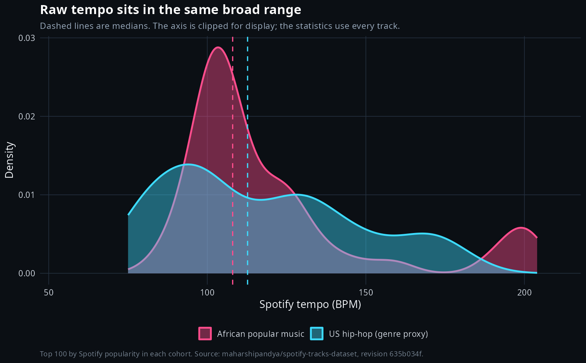
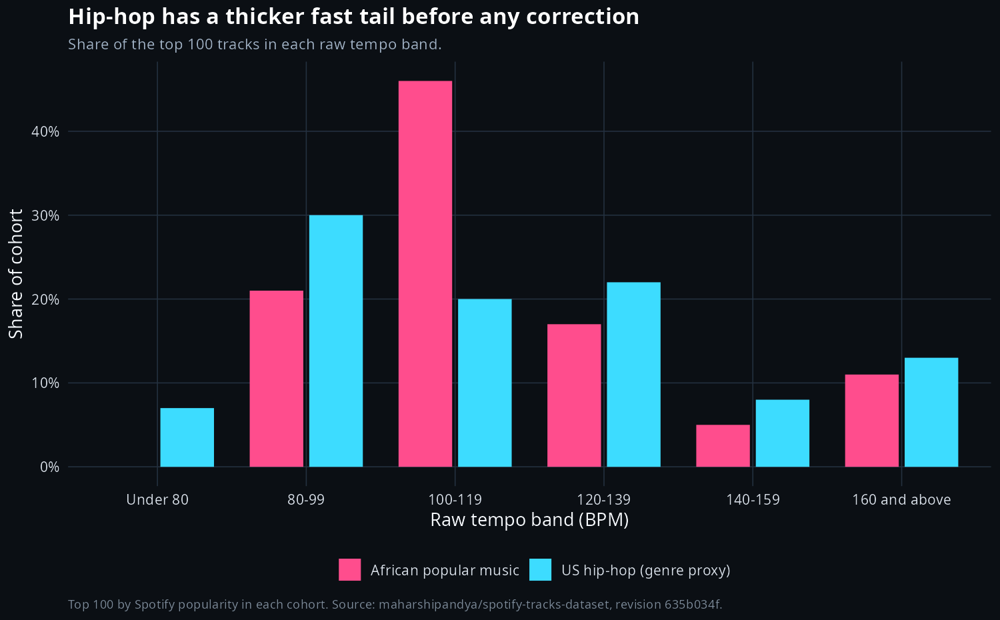
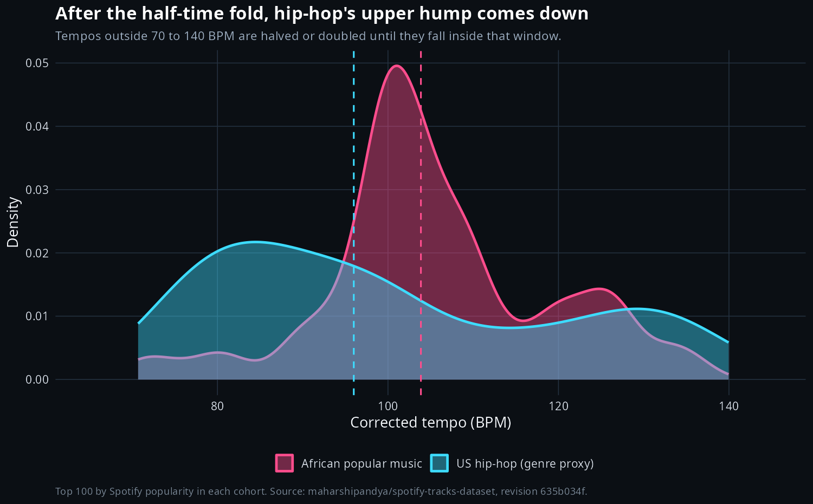
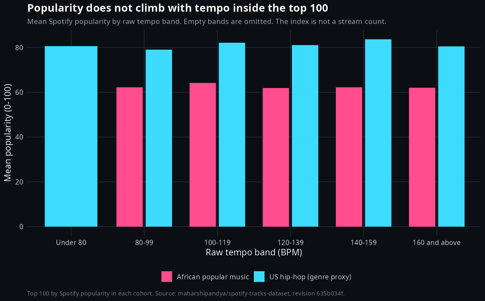

# BPMAnalytics

How does the tempo of the most popular African-scene tracks in a public Spotify catalog compare with the most popular tracks tagged hip-hop?

On the tempo Spotify stored, the two groups are not meaningfully different. The medians sit a few BPM apart, the means point the other way, and both effect sizes are negligible. A half-time fold that cuts at 140 BPM opens a small gap. A fold that cuts at 160 BPM does not. This file is not a chart of Africa or of the United States, and the write-up below does not treat it as one.



## Key findings

The headline set is the 100 highest-popularity tracks in each cohort. Africa top tracks: 100. Hip-hop top tracks: 100. Africa top-100 popularity runs from 56 to 92. Hip-hop top-100 popularity runs from 72 to 99. Mean popularity in those sets is 63.0 and 80.7. The hip-hop set sits higher on Spotify's global popularity index, so the two lists are not matched on how widely they were played.

Africa median raw tempo: 108.0 BPM. Hip-hop median raw tempo: 112.7 BPM. Median raw gap (Africa minus hip-hop): -4.7 BPM. The means reverse that sign because a cluster of African tracks is tagged near 200 BPM: Africa mean raw tempo: 120.2 BPM (sd 31.0). Hip-hop mean raw tempo: 117.0 BPM (sd 29.8). Mean raw gap (Africa minus hip-hop): 3.2 BPM. Hip-hop is the wider distribution. Africa raw IQR: 25.6 BPM. Hip-hop raw IQR: 43.0 BPM. Raw tempo runs from 82.7 to 204.0 BPM in the African top 100 and from 75.0 to 180.2 BPM in the hip-hop top 100.

Forty-six of the African top 100 fall in the 100–119 band, and none fall under 80. Hip-hop's largest band is 80–99 (30 tracks), with 7 tracks under 80. Hip-hop tracks at or above 140 BPM raw: 21.0%. Africa tracks at or above 140 BPM raw: 16.0%.

Welch t (raw) = 0.73 on 197.7 df, p = 0.463. Cohen's d (raw) = 0.10. Mann-Whitney p (raw) = 0.380. Cliff's delta (raw) = 0.07. Cohen's benchmarks usually treat about 0.2 as a small effect. A common set of cut points for Cliff's delta treats about 0.15 as negligible. Both raw effect sizes are negligible. A positive Cliff's delta means a random African-cohort track is a bit more often the faster of a random pair. The median says the opposite about the center of the distribution. With effects this small, that disagreement is the skew, not a finding to act on.

The same null shows up if the popularity floor is kept and the top-100 cut is dropped. Africa eligible tracks: 208. Hip-hop eligible tracks: 553. Eligible-set Mann-Whitney p (raw) = 0.249. Eligible-set Cliff's delta (raw) = 0.05.



### Half-time and double-time

Spotify's tempo is an estimate. On rap drums it often locks onto double the pulse a listener counts, so a track felt near 80 BPM is stored near 160. The pipeline folds any tempo outside `[70, 140)` by halving or doubling until it lands inside. That is a sensitivity check, not a claim that the folded number is the true tempo.

In the top 100, every moved track was halved. None were doubled. The slowest headline tempos were already inside the window (82.7 and 75.0 BPM). Doubling does exist in the code: 3 eligible tracks below the top 100 were doubled. Africa tracks with an octave shift: 16.0%. Hip-hop tracks with an octave shift: 21.0%. In this headline set those shares equal the shares at or above 140 BPM, because the shift and the 140 cut are the same tracks.

The African tracks that move are the ones stored near 200 BPM, which fold back to about 100 and join the main peak. Omah Lay's "Lo Lo" is stored at 204.0 and folds to 102.0. Burna Boy's "Ye" is stored at 201.9 and folds to 100.9. Hip-hop's fast tags sit lower, so they fold lower: Drake's "Jimmy Cooks" goes from 165.9 to 83.0, and Lil Nas X's "STAR WALKIN'" goes from 141.9 to 70.9.



After that fold, Africa median corrected tempo: 103.9 BPM. Hip-hop median corrected tempo: 96.0 BPM. Median corrected gap (Africa minus hip-hop): 7.9 BPM. Africa mean corrected tempo: 105.5 BPM. Hip-hop mean corrected tempo: 100.0 BPM. Mean corrected gap (Africa minus hip-hop): 5.6 BPM.

Welch t (corrected) = 2.33 on 171.6 df, p = 0.021. Cohen's d (corrected) = 0.33. Mann-Whitney p (corrected) = 0.002. Cliff's delta (corrected) = 0.25. A d of 0.33 and a Cliff's delta of 0.25 are small, not large. The Mann-Whitney result is the primary one: corrected tempo is still lopsided, and the test does not need normal data.

That small gap depends on cutting at 140. The alternate window `[80, 160)` leaves the 140s alone and only halves tempos of 160 and above. Its medians are 104.0 and 103.0 BPM. Alternate window [80, 160) Mann-Whitney p = 0.550. Alternate window Cliff's delta = 0.05. The half-time story is real as a description of where the estimator puts the fast tail. It is not a stable claim that one cohort is faster.

### Popularity and tempo

Mean popularity barely moves across tempo bands inside either top 100. The hip-hop bars sit higher at every band because those tracks are more popular in this file, not because faster tracks are more popular.



## What the two cohorts actually are

The source file has no country, no chart position, and no listener market. Genre labels are a poor substitute, and one of them fails in a way you can see.

`track_genre = afrobeat` is not the Africa cohort. Afrobeat-label top 25 on the lookup: 3 of 25. The most popular row with that label is Calle 13's "Atrévete-Te-Te". The head of the label is mostly Latin alternative and American retro-soul. Three of those 25 rows are on the artist list used here (Mulatu Astatke twice, Letta Mbulu once). A zero on that flag does not prove an artist is from outside Africa. The list is incomplete. It does show that the genre string is not a list of top African songs.

**African popular music.** The primary artist is the name before the first `;` in `artists`. A featured credit does not qualify the track. The primary name has to match `data/reference/african_primary_artists.csv`. Artist lookup size: 55 names. The list is musicians publicly identified with a national popular-music scene in Africa. It was built for this project because the file has no country field. It is not a chart, it misses artists who are not on it, and a lead credit is not a passport. Nigeria accounts for 91 of the African top 100. The other nine are Ghana (4), South Africa (3), Cape Verde (1), and Côte d'Ivoire (1). Ethiopia, Cameroon, Mali, and Senegal are on the list and in the catalog, but their tracks in this file sit below the top-100 popularity cut. "Africa" in the charts above is, in practice, mostly Nigerian popular music as Spotify's global index ranks it.

**US hip-hop (genre proxy).** `track_genre = hip-hop`, and the primary artist is not on the African list. The file never says the track charted in the United States. The most popular row is Bizarrap and Quevedo. Lizzo's "About Damn Time" is in the top 100. Future's "WAIT FOR U" features Tems and stays in this cohort because Future is billed first. Those rows are left in. Dropping them would be a second filter that the code does not apply.

Shared rules, both cohorts:

- Tempo must be positive, duration must be between 30 seconds and 20 minutes, and the time signature must be from 3 to 7.
- One row per Spotify track id, keeping the highest popularity.
- Then one row per primary artist plus exact title, so a second upload of the same title does not get a second vote.
- Popularity at least 40. That floor is what this file supports. A cut at 70 would leave only a handful of African-scene tracks.
- `is_top100` marks the 100 highest-popularity rows inside that eligible set. Ties break on track id.

The eligible African set is 208 titles, down from 543 catalog rows with a matching primary artist, after the quality screen and the two dedupe steps. The eligible hip-hop set is 553 titles.

## Data source and limits

| Item | Detail |
| --- | --- |
| Dataset | [maharshipandya/spotify-tracks-dataset](https://huggingface.co/datasets/maharshipandya/spotify-tracks-dataset) |
| Revision | `635b034f69257814eff850a5c2b3346fe458134f` |
| File | `dataset.csv` |
| SHA-256 | `b202fa49909b2d5cef71a04b1d21243cfeb36414535f2ca9272aa646721177bd` |
| License on the dataset card | `bsd` |
| Shape | 114,000 rows, 114 genre labels, about 1,000 rows per label |

The card says the table was collected with Spotify's Web API. It does not give the day the features were pulled. Popularity is the 0–100 index stored in the file, not a live rank and not a stream count. The card's own description says that index depends on recent plays, so two tracks with the same lifetime audience can score differently.

This file is the one used because public chart dumps that name a country do not include tempo, and Spotify's audio-features endpoint is closed to new apps. Nothing here calls that API. The BSD card license allows redistribution of the analysis. The raw 20 MB CSV is not committed. `scripts/download_data.py` fetches the pinned revision and checks the hash.

Limits that should travel with any number above:

- Not a radio chart, a Billboard list, or a national top 50.
- The African cohort inherits every gap in a 55-name list, and the top 100 is 91 percent Nigerian.
- The hip-hop tag is a genre proxy with visible non-hip-hop and non-US rows.
- Tracks are not a random sample. The file was built as a genre sample.
- Alternate versions with different titles are kept. Exact duplicate titles are not.
- Tempo is an estimator with octave errors. The two fold windows do not agree.
- The cohorts are not matched on popularity.

## How to run

Python 3.9 or newer, pandas, pytest, and R with ggplot2, jsonlite, and testthat.

```bash
python scripts/download_data.py
python scripts/run_pipeline.py
pytest -q
Rscript -e "testthat::test_dir('tests/testthat', stop_on_failure = TRUE)"
```

`run_pipeline.py` writes the analysis table, the SQLite warehouse, the SQL extracts, the Power BI CSVs, `outputs/results.json`, and the four figures. It stops if the SQL medians and the R medians disagree, or if the SQL fold and the Python fold disagree. GitHub Actions runs the same sequence.

The processed analysis table and the figures are already in the repo, so the charts above render without a download. Re-run the pipeline when you want to rebuild them from the pinned CSV.

## Project structure

```
data/reference/african_primary_artists.csv   artist lookup
data/processed/analysis_tracks.csv           eligible tracks, both cohorts
sql/                                         schema and analysis queries
src/bpm_analytics/                           download-to-table Python
R/analysis.R                                 tests, effect sizes, figures
R/tempo_stats.R                              fold, Cohen's d, Cliff's delta
powerbi/star/                                dim and fact CSVs
powerbi/measures.dax                         measures for the model
powerbi/theme.json                           dark theme
docs/power-bi-build-guide.md                 PL-300 build steps
outputs/figures/                             the charts in this file
outputs/sql/                                 results of the SQL queries
tests/                                       pytest and testthat
```

The SQL is aggregation, not a dump of the table. `sql/01_cohort_summary.sql` computes the mean, the sample standard deviation, and the median from row numbers. `sql/03_octave_correction.sql` re-folds tempo with a `CASE` and splits halved, doubled, and unshifted tracks. `sql/04_popularity_by_tempo_band.sql` averages popularity by band. `sql/05_country_tempo.sql` is descriptive only. `sql/06_afrobeat_label_audit.sql` is the label check.

## Methods, short version

Mann-Whitney is the primary test. Raw tempo is skewed, and the fast tail makes a normal assumption hard to love. Welch's t-test is the companion. It does not assume equal variance. Cohen's d uses the pooled standard deviation. Cliff's delta is the share of pairs where the African track is faster, minus the share where the hip-hop track is faster. The reported Mann-Whitney p-values use the normal approximation with a continuity correction, which is what you want once there are ties.

The raw comparison was the recorded measure. The `[70, 140)` fold was the pre-set half-time check. The `[80, 160)` window was run because a cut at 140 is a choice. Both are in `outputs/results.json`.

## Power BI

The star schema and the measures are ready to load. The build steps, including which PL-300 skill each step practices, are in [docs/power-bi-build-guide.md](docs/power-bi-build-guide.md). There is no `.pbix` in this repo. The point of the guide is to build the model yourself. After the top-100 filter, Median Tempo Raw should show 108.0 for the African cohort and 112.7 for hip-hop.

## Next steps

- Build the report from the guide and check the cards against the figures in this file.
- If an openly licensed chart dataset ever ships with tempo attached, replace these proxy cohorts. Do not fill the gap by calling the closed audio-features API.
- Match the two cohorts on popularity and repeat the tests. The raw result is already null without that match. The corrected gap has not been checked that way.
- Extend the artist list, and publish the reason for every name added. A longer list changes who is in the top 100.

## License

The code and the write-up are under the MIT license in `LICENSE`. The track catalog stays under the BSD license declared on the dataset card. The artist lookup is a list of names and countries assembled for this analysis, not a copy of the catalog.
